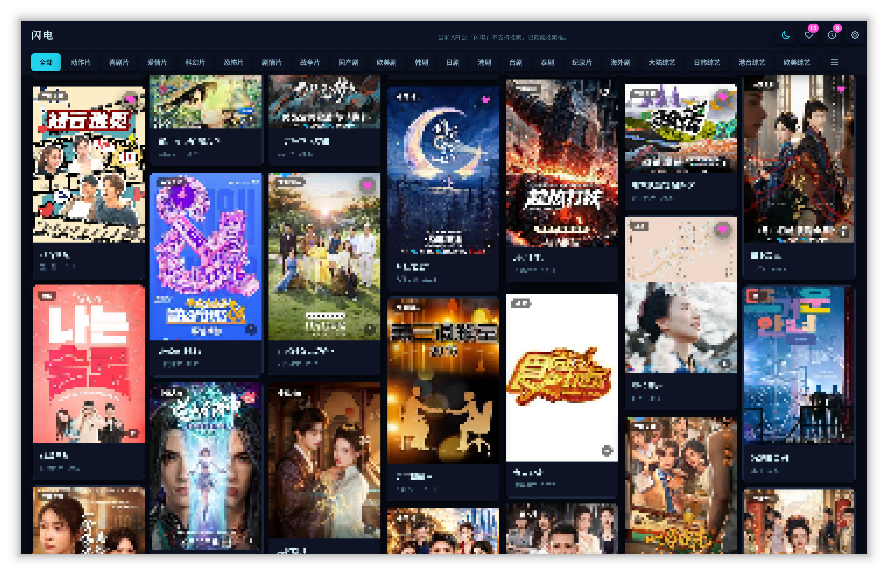
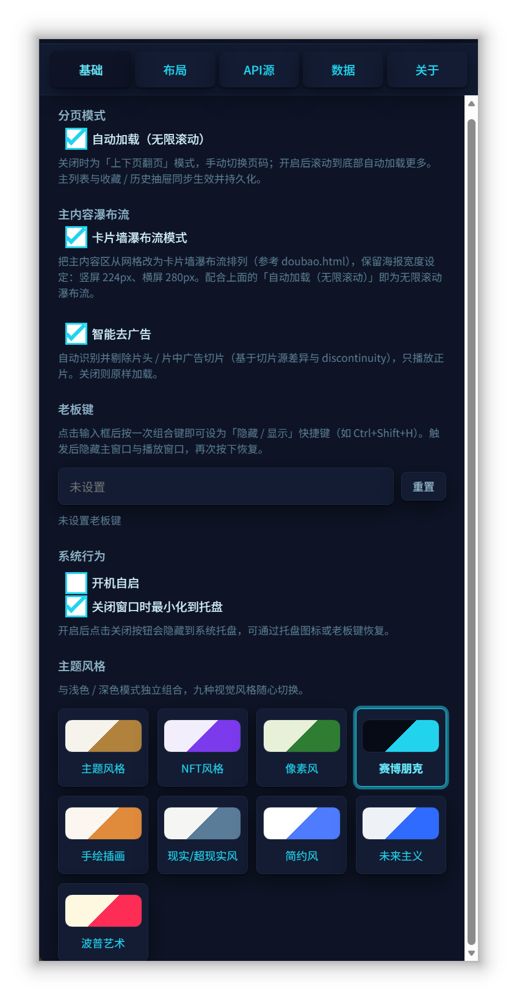
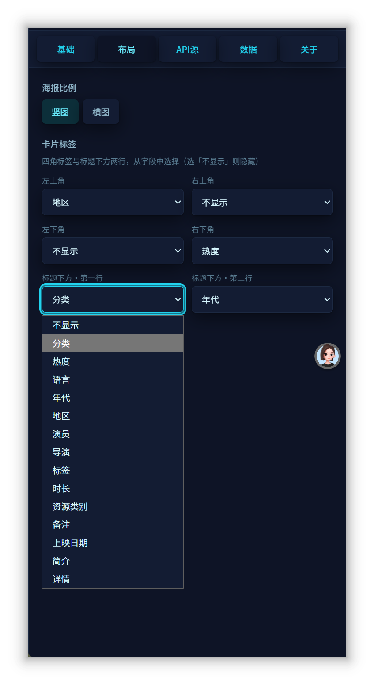
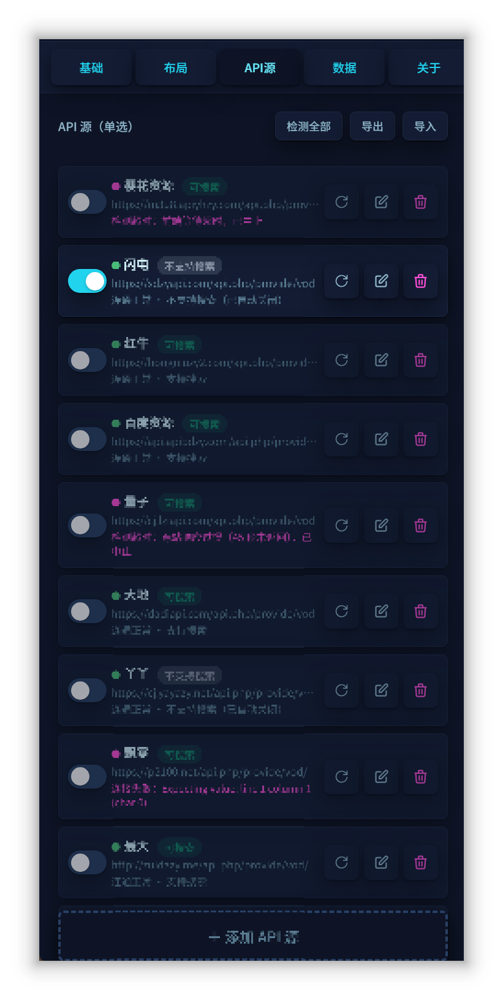
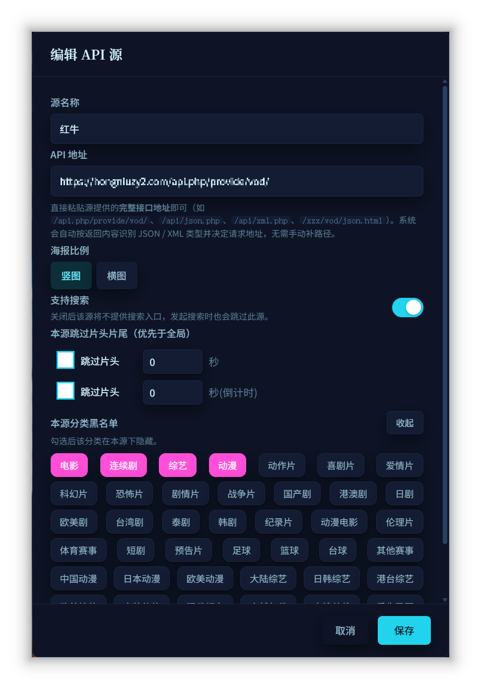
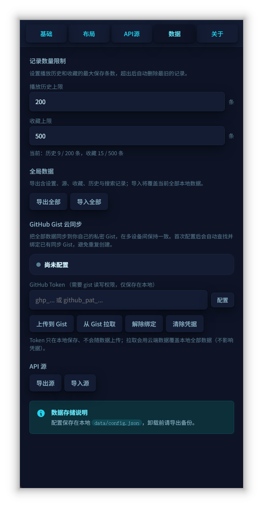

<h1 align="center">
  
  <br>
  <a href="https://github.com/pcoof/PPPlayer/releases">PPPlayer 桌面版</a>
  <br>
</h1>
<div align="center">

[](https://github.com/pcoof/PPPlayer/releases)
[](#许可证)
[](https://www.python.org/)
</div>
<div align="center">

[](https://readmex.com/pcoof/PPPlayer)
[](https://deepwiki.com/pcoof/PPPlayer)
[![](https://img.shields.io/badge/Ask_Zread-_.svg?style=flat&color=00b0aa&labelColor=000000&logo=data%3Aimage%2Fsvg%2Bxml%3Bbase64%2CPHN2ZyB3aWR0aD0iMTYiIGhlaWdodD0iMTYiIHZpZXdCb3g9IjAgMCAxNiAxNiIgZmlsbD0ibm9uZSIgeG1sbnM9Imh0dHA6Ly93d3cudzMub3JnLzIwMDAvc3ZnIj4KPHBhdGggZD0iTTQuOTYxNTYgMS42MDAxSDIuMjQxNTZDMS44ODgxIDEuNjAwMSAxLjYwMTU2IDEuODg2NjQgMS42MDE1NiAyLjI0MDFWNC45NjAxQzEuNjAxNTYgNS4zMTM1NiAxLjg4ODEgNS42MDAxIDIuMjQxNTYgNS42MDAxSDQuOTYxNTZDNS4zMTUwMiA1LjYwMDEgNS42MDE1NiA1LjMxMzU2IDUuNjAxNTYgNC45NjAxVjIuMjQwMUM1LjYwMTU2IDEuODg2NjQgNS4zMTUwMiAxLjYwMDEgNC45NjE1NiAxLjYwMDFaIiBmaWxsPSIjZmZmIi8%2BCjxwYXRoIGQ9Ik00Ljk2MTU2IDEwLjM5OTlIMi4yNDE1NkMxLjg4ODEgMTAuMzk5OSAxLjYwMTU2IDEwLjY4NjQgMS42MDE1NiAxMS4wMzk5VjEzLjc1OTlDMS42MDE1NiAxNC4xMTM0IDEuODg4MSAxNC4zOTk5IDIuMjQxNTYgMTQuMzk5OUg0Ljk2MTU2QzUuMzE1MDIgMTQuMzk5OSA1LjYwMTU2IDE0LjExMzQgNS42MDE1NiAxMy43NTk5VjExLjAzOTlDNS42MDE1NiAxMC42ODY0IDUuMzE1MDIgMTAuMzk5OSA0Ljk2MTU2IDEwLjM5OTlaIiBmaWxsPSIjZmZmIi8%2BCjxwYXRoIGQ9Ik0xMy43NTg0IDEuNjAwMUgxMS4wMzg0QzEwLjY4NSAxLjYwMDEgMTAuMzk4NCAxLjg4NjY0IDEwLjM5ODQgMi4yNDAxVjQuOTYwMUMxMC4zOTg0IDUuMzEzNTYgMTAuNjg1IDUuNjAwMSAxMS4wMzg0IDUuNjAwMUgxMy43NTg0QzE0LjExMTkgNS42MDAxIDE0LjM5ODQgNS4zMTM1NiAxNC4zOTg0IDQuOTYwMVYyLjI0MDFDMTQuMzk4NCAxLjg4NjY0IDE0LjExMTkgMS42MDAxIDEzLjc1ODQgMS42MDAxWiIgZmlsbD0iI2ZmZiIvPgo8cGF0aCBkPSJNNCAxMkwxMiA0TDQgMTJaIiBmaWxsPSIjZmZmIi8%2BCjxwYXRoIGQ9Ik00IDEyTDEyIDQiIHN0cm9rZT0iI2ZmZiIgc3Ryb2tlLXdpZHRoPSIxLjUiIHN0cm9rZS1saW5lY2FwPSJyb3VuZCIvPgo8L3N2Zz4K&logoColor=ffffff
)](https://zread.ai/pcoof/PPPlayer)
[](https://gitdiagram.com/pcoof/PPPlayer)


</div>
# PPPlayer — pywebview 桌面版

> 本项目由 **AI 编写**，整体设计思路（架构、功能取舍、UI/交互方案）也来自 AI。它是对「用 Python + pywebview 做一个轻量桌面视频聚合播放器」这一想法的落地实现。

PPPlayer 是一款基于 **Python + pywebview** 的开源视频聚合播放桌面应用。它聚合多种影视 CMS API 接口（苹果CMS / 飞飞CMS / 海洋CMS 等），内置 M3U8 智能广告过滤与媒体嗅探，所有数据均保存在本地。

## 技术栈

- **Python 3.11+** + uv 包管理
- **pywebview** — 无边框桌面窗口容器（自定义标题栏、边缘缩放、Aero Snap）
- **Flask** — 内置 HTTP 服务器（`127.0.0.1:19527`，嵌入 pywebview）
- **前端** — 原生 CSS（单一设计系统 `style.css`，含语义化组件类 + 轻量工具类层 `u-*`）+ Alpine.js + HLS.js + XGPlayer（弹出播放页）

## 界面预览

截图存放于 [`doc/img/`](doc/img/)，更多说明见 [文档索引](doc/README.md)。

| 主界面 · 卡片墙瀑布流 | 设置中心 · 基础 |
|:---:|:---:|
|  |  |

| 设置中心 · 布局（卡片标签自定义） | 设置中心 · API 源 |
|:---:|:---:|
|  |  |

| 编辑 API 源 | 设置中心 · 数据（Gist 云同步） |
|:---:|:---:|
|  |  |

## 功能

- 多 CMS 源支持（苹果CMS JSON / 飞飞CMS XML / 海洋CMS 自动适配）
- 搜索、分类浏览、自动加载（滚动无限加载）/ 分页两种模式
- 收藏、播放历史、搜索历史
- 卡片标签自定义（四角 + 标题下方双行）
- CMS 源分类黑名单（按源独立配置）
- **源连接检测** — 设置「API 源」中可单源「检测连接」或「检测全部」，状态以彩色圆点（绿/红/灰）显示，检测中图标旋转
- 片头片尾跳过、自动连播、倍速记忆
- **M3U8 智能去广告**（默认开启）— 自动识别并剔除片头 / 片中广告切片（基于切片源目录签名差异与 `#EXT-X-DISCONTINUITY` 分段），只播放正片；关闭则原样加载
- 主题系统 — 浅色 / 深色 / 跟随系统，叠加 **九套视觉风格**（默认 / NFT / 像素风 / 赛博朋克 / 手绘插画 / 现实·超现实 / 简约 / 未来主义 / 波普艺术），独立组合
- 数据导入导出（JSON 格式，含收藏 / 历史 / 源 / 配置）
- **GitHub Gist 云同步**（设置中心 → 数据）— 把全部本地数据同步到你自己的**私密 Gist**，多设备保持一致：配置 GitHub Token 后自动查找并绑定已有同步 Gist（按固定标记识别，**避免重复创建**），支持「上传到 Gist」/「从 Gist 拉取」，界面展示绑定状态、最近同步时间、最近操作结果与错误信息。Token 仅保存在本地 `data/gist_sync.json`、不明文回显、不随数据上传；拉取只覆盖应用数据、不影响凭据。Token 需具备 gist 读写权限（Fine-grained token 需 `Gists: write`）
- **切源 / 切分类 / 搜索的毛玻璃等待层** — 整页重载时（切换 API 源、切换分类、搜索、首次加载）内容区与导航菜单叠加一层毛玻璃模糊 + 居中加载动画，弱响应期间给出明确反馈；该层被限制在主内容容器内，**绝不遮挡顶部标题栏**（窗口标题栏始终清晰可交互）。无限滚动「加载更多」为增量追加，不触发模糊层
- **播放页全屏控制栏** — 全屏时鼠标移到**顶部**显示顶栏（返回 / 集数 / 全屏 / 置顶 / 窗口按钮），移到**底部**显示底部控件与「设置 / 选集」入口，静止约 3 秒自动隐藏；顶栏图钉按钮可**固定 / 取消固定**控制栏（固定时常显，状态持久化）。拖动进度条 / 点击控件 / 鼠标悬停 / 设置面板打开时均**不会误隐藏**；窗口模式下顶栏保持常显（兼作拖拽标题栏），原交互不受影响
- **播放背景切换** — 播放设置中可选「封面」（视频外留白用封面图模糊填充，默认）或「黑底」（纯黑填充），选择持久化
- **GitHub 更新镜像回退** — 检查更新与下载均**先直连 GitHub**，遇到连接失败 / 非 200 / 下载流中断时自动改用 `https://cdn.gh-proxy.org/` 镜像重试，解决国内网络下 GitHub 不可达导致「检查更新没反应」；两路都失败才明确报错。Gist 同步含 Token，**不走第三方镜像**
- **滚动条跟随主题** — 主内容、设置面板、播放器侧栏、选集列表等所有滚动区域的滚动条颜色统一取主题令牌（`--line-strong` / `--ink-3`），深浅色与九套视觉风格切换时自动同步

## 🌴 注意事项

- 仅此Github发布，请勿上当受骗；请各管理者不要宣传及引流本软件。
- 强烈倡导合法观影，本软件仅作为播放工具，不涉及资源存储或分发。
- 仅供个人学习交流之用，24小时内请自觉卸载，勿作商业用途。
- 在开始使用前，请务必详读并同意用户协议，确保遵守相关规定。

## 安装

```bash
cd PPPlayer

# 安装依赖
uv sync
```

> 说明：仓库与本地目录名仍为 `PPPlayer`（GitHub 仓库未迁移），但应用显示名已统一为 **PPPlayer**。

## 运行

```bash
uv run main.py
```

首次启动会自动打开 pywebview 窗口（1280×800），标题为 "PPPlayer"。

## Docker 本地 Web 冒烟测试

只想验证 Flask 服务、静态页面、API 与配置挂载（不启动 pywebview 桌面窗口）时，可以使用本地镜像：

```bash
docker compose up -d --build
docker compose logs -f web
docker compose ps
```

浏览器访问：

- `http://localhost:19528/` — 主页面
- `http://localhost:19528/player` — 播放页面

停止服务：

```bash
docker compose down
```

> 注意：容器只做 Web 冒烟测试，不启动 pywebview，无法验证独立播放器窗口居中、置顶、拖拽、全屏等桌面能力；这些必须在 Windows 真机执行 `uv run main.py` 验证。容器与桌面端不要同时运行并共用同一份 `data/`，避免配置互相覆盖。

## 构建与发布（Windows 单文件 exe）

通过 GitHub Actions（`.github/workflows/build.yml`）自动构建发布 **Windows 单文件 exe**，产物为 `ppplayer.exe`（单文件）与 `ppplayer-portable.zip`（便携包）。构建期写回版本号并嵌入 Windows 版本资源，源码不维护固定版本常量。

CI 流程、本地打包命令、版本号来源与应用内自更新的完整说明见 **[构建与发布](doc/构建与发布.md)**。

## 项目结构

```
PPPlayer/
├── pyproject.toml           # uv 项目配置（版本号唯一来源：project.version）
├── uv.lock                  # 依赖锁文件
├── Dockerfile               # 本地 Web 测试镜像（最小依赖，不导入 main.py）
├── docker-compose.yml       # 本地 Web 冒烟测试服务（19528 -> 19527）
├── .dockerignore            # 排除桌面端/临时文件，缩小镜像构建上下文
├── requirements.web.txt     # 容器 Web 测试最小依赖
├── main.py                  # 入口：启动 Flask + pywebview、托盘、窗口管理、系统事件
├── README.md                # 本文件
├── logo.ico                 # 应用图标
├── .github/workflows/
│   └── build.yml            # CI：版本计算 + 打包 + 版本资源 + 发布 Release
├── data/                    # 运行时生成（首次启动后存在）
│   ├── config.json          # 本地配置（源、收藏、历史、设置）—— Gist 同步的数据内容
│   └── gist_sync.json       # Gist 凭据/状态（Token、gist_id、最近同步时间）—— 独立存储，不被同步覆盖
├── doc/                     # 文档与截图
│   ├── README.md            # 文档索引
│   ├── 构建与发布.md         # CI / 打包 / 版本 / 自更新
│   ├── M3U8去广告与同源代理.md # 播放列表过滤与同源代理原理
│   └── img/                 # 界面截图（main / base / layout / api / edit-api / data）
├── src/
│   ├── server.py            # Flask 应用，挂载所有路由
│   ├── gist_sync.py         # GitHub Gist 数据同步（查找/绑定/上传/拉取）
│   ├── updater.py           # 应用内更新（检查/下载/镜像回退/自更新重启）
│   ├── config_store.py      # 配置持久化（config.json 读写）
│   ├── cms/
│   │   ├── base.py          # CMS 抽象基类
│   │   ├── detector.py      # CMS 类型自动检测
│   │   ├── endpoint.py      # 接口地址拼接与容错
│   │   ├── http.py          # 网络请求（IPv4 优先 / TLS Happy Eyeballs / 绕系统代理）
│   │   ├── apple_cms.py     # 苹果CMS (JSON API)
│   │   ├── feifei_cms.py    # 飞飞CMS (XML API)
│   │   └── haiyang_cms.py   # 海洋CMS (XML/JSON API)
│   └── parser/
│       ├── sniffer.py       # 媒体嗅探器
│       └── m3u8_filter.py   # M3U8 智能广告过滤
└── static/
    ├── index.html           # 前端主页面（Alpine.js）
    ├── player.html          # 弹出播放页（XGPlayer 竖滑）
    ├── logo.svg / logo.ico  # 前端 Logo
    ├── thumb.svg            # 卡片占位图
    ├── css/
    │   └── style.css        # 设计系统「纸上观影 / Paper & Reel」+ 工具类层
    ├── js/
    │   ├── api.js           # API 调用封装
    │   ├── app.js           # 主应用逻辑 (Alpine.js)
    │   ├── window-chrome.js # 无边框窗口拖拽 / 缩放 / Aero Snap
    │   └── alpine.min.js    # Alpine.js（本地内联依赖）
    └── vendor/              # 第三方前端库（XGPlayer / Swiper / HLS.js 等）
```

## API 路由

| 路由 | 说明 |
|---|---|
| `GET /` | 返回 index.html |
| `GET /static/<path>` | 静态文件 |
| `GET /api/hls?url=<url>` | 播放列表代理：后端拉取 + 智能去广告，并把内部所有 CDN 地址改写为同源代理；302 到 `.m3u8` 结尾地址供播放器识别为 HLS |
| `GET /api/media?url=<url>` | 媒体字节代理（切片 `.ts/.m4s`、密钥 `.key`、字幕 `.vtt` 等），转发 `Range` 请求支持拖动进度，同源返回规避跨域 |
| `GET /api/serve_m3u8/<sid>` | 返回已暂存的过滤后播放列表（`.m3u8` 结尾，供播放器识别为 HLS） |
| `GET /api/parse?url=<url>` | 媒体嗅探解析 |
| `GET /api/cms/classes?source=<url>` | 获取 CMS 分类 |
| `GET /api/cms/videos?source=<url>&ac=&pg=&t=&wd=` | 获取视频列表 |
| `GET /api/cms/detail?source=<url>&id=<id>` | 获取视频详情 |
| `GET /api/cms/check?source=<url>` | 检测 CMS 源连通性（设置中心「检测连接」调用） |
| `GET /api/gist/status` | Gist 同步状态（绑定/最近同步时间/错误，Token 只回掩码） |
| `POST /api/gist/configure` `{token}` | 校验 Token 并自动查找绑定已有同步 Gist |
| `POST /api/gist/upload` | 上传本地全部数据到 Gist（未绑定则自动查找/创建） |
| `POST /api/gist/pull` | 从 Gist 拉取并覆盖本地数据 |
| `POST /api/gist/unbind` / `clear` | 解除绑定 / 清除本地凭据 |
| `GET /api/update/status` · `POST /api/update/start` · `POST /api/update/apply` | 应用内更新：状态 / 下载 / 应用并重启 |
| `GET /player` | 弹出式竖滑播放页 |

## M3U8 智能去广告 + 同源代理

播放全程**只与本地 Flask 服务（127.0.0.1:19527）同源通信**，从根源规避 CDN 跨域失败；后端按 discontinuity 切段、归并正片源、剔除广告，并把所有 CDN 地址改写为同源代理。原理、流程图与相关路由见 **[M3U8 智能去广告 + 同源代理](doc/M3U8去广告与同源代理.md)**。

## 主题与风格

- 浅色 / 深色 / 跟随系统（设置中心 → 基础 → 主题）
- 九套视觉风格（设置中心 → 基础 → 主题风格），与明暗模式独立组合，由 `style.css` 中 `html[data-theme="..."]` 令牌覆盖实现
- 独立播放器页（`/player` 与弹出播放器窗口）固定夜间主题 + 默认视觉风格，不随主应用主题/风格切换；播放背景的封面 / 黑底模式仍可切换

## 许可证

MIT
*（本项目由 AI 编写、设计思路亦来自 AI；内容仅供学习交流参考，请勿用于任何商业或侵权行为。）*
